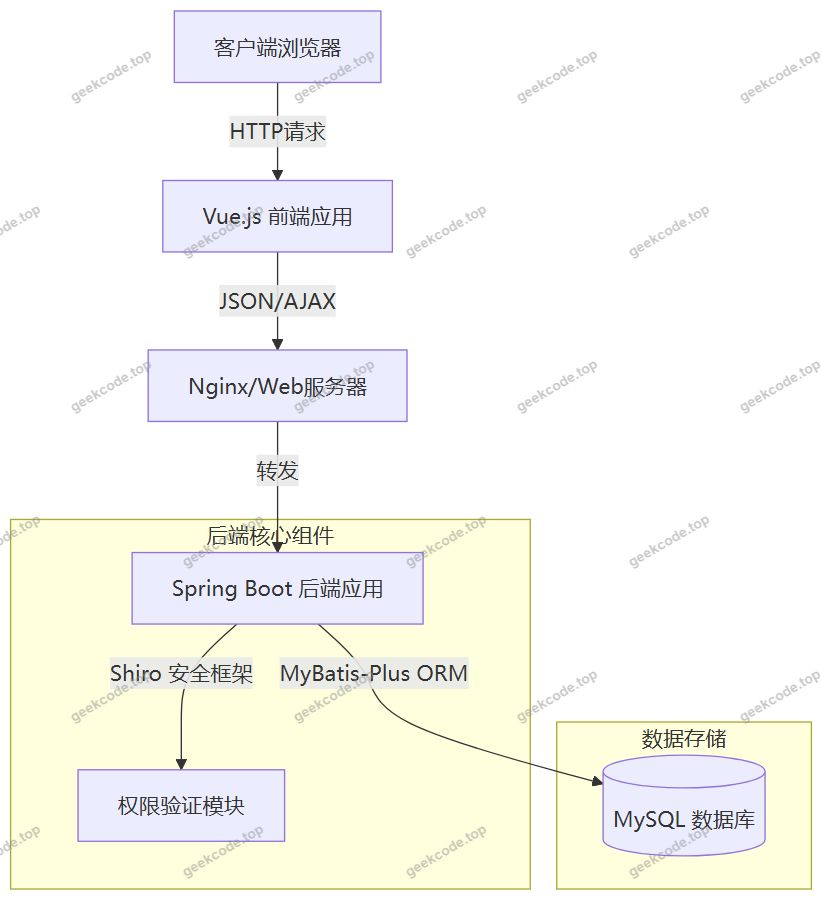
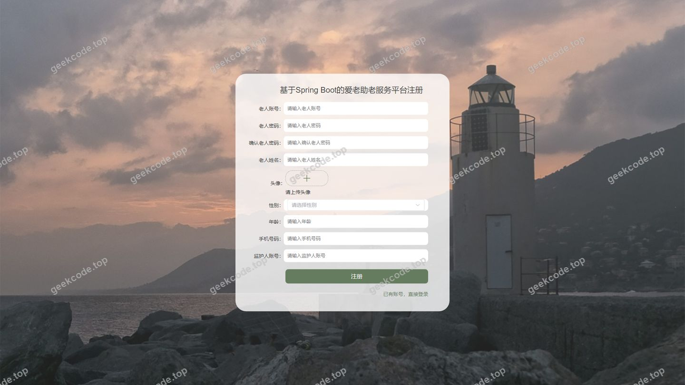
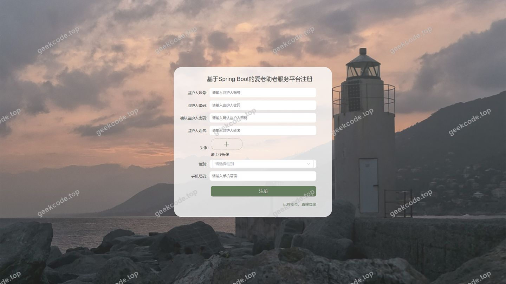
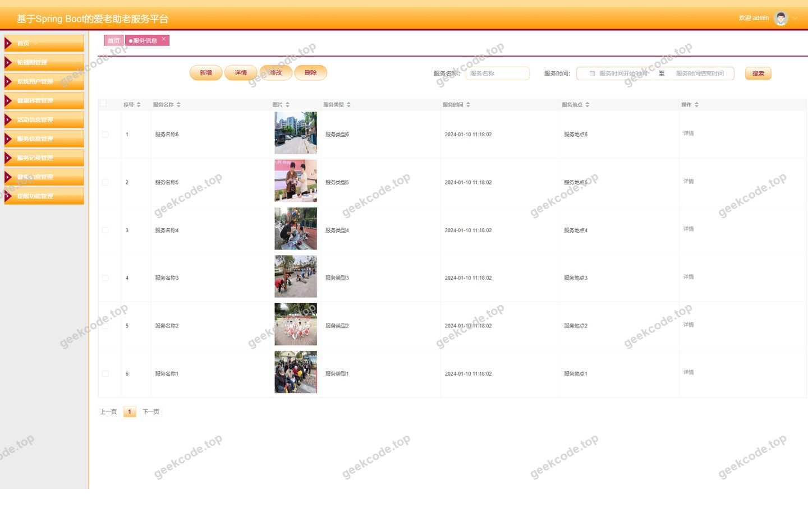
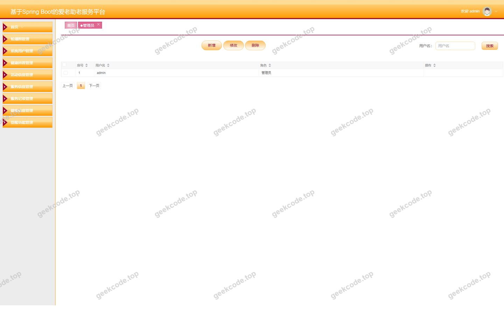
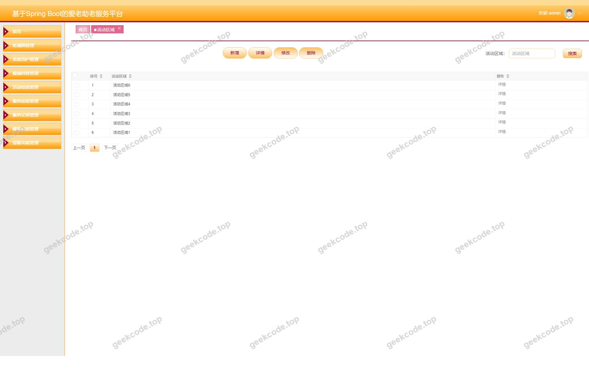
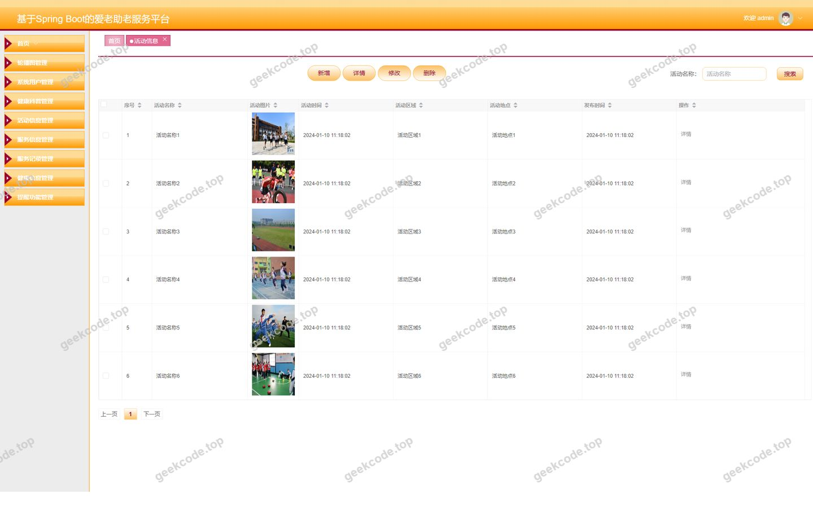
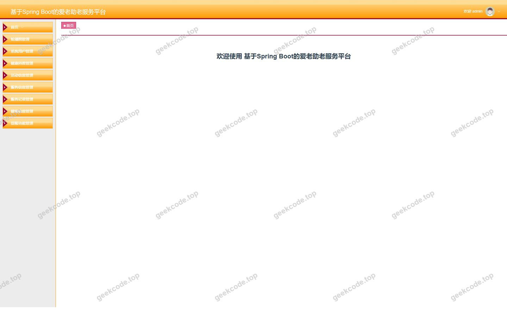
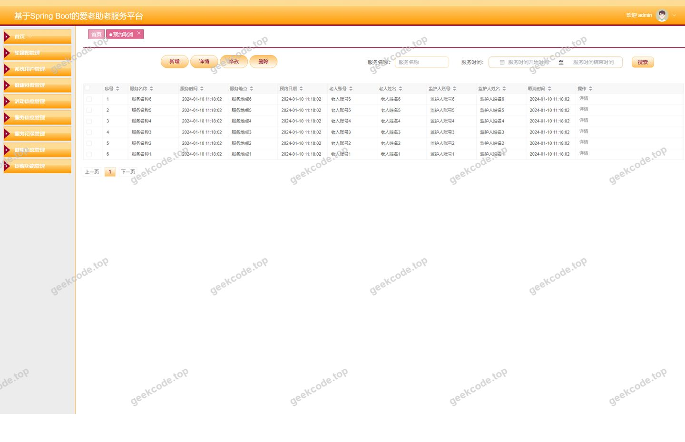

# 基于Spring Boot的爱老助老服务平台

> 🎓 **计算机毕业设计 · 基于Spring Boot的爱老助老服务平台**
>
> 本仓库只放**项目介绍 + 运行截图**（截图是站点带水印的原图，存在仓库 `images/` 里）。
>
> 👉 **完整可运行源码 / 数据库脚本 / 部署文档：[点我获取](https://geekcode.top/archives/%E5%9F%BA%E4%BA%8ESpring-Boot%E7%9A%84%E7%88%B1%E8%80%81%E5%8A%A9%E8%80%81%E6%9C%8D%E5%8A%A1%E5%B9%B3%E5%8F%B0?utm_source=github)**
>
> 💬 咨询微信：**ir9372**　|　🌐 更多项目：[极客代码 geekcode.top](https://geekcode.top/?utm_source=github)
>
> 📌 项目详情页：<https://geekcode.top/archives/%E5%9F%BA%E4%BA%8ESpring-Boot%E7%9A%84%E7%88%B1%E8%80%81%E5%8A%A9%E8%80%81%E6%9C%8D%E5%8A%A1%E5%B9%B3%E5%8F%B0?utm_source=github>

<table><td width="230" align="center"> <b>扫码加微信 ir9372</b></td><td valign="middle">📦 源码 = 项目介绍 + 全部运行截图 + 数据库 + 部署文档 👉 点上方任意截图，直接跳到 <b>极客代码 geekcode.top</b> 详情页</td></table>

---

<h1>基于Spring Boot的爱老助老服务平台</h1>
<h2>项目概述</h2>

本项目旨在构建一个基于 Spring Boot 的爱老助老服务平台，以应对人口老龄化背景下养老服务资源匹配难、健康管理信息分散及志愿服务效率低等核心问题。平台采用前后端分离架构，整合了老人、监护人、志愿者三类用户角色，实现了从健康数据监测、服务预约到志愿者管理的全流程数字化闭环。

系统核心功能涵盖老人档案管理、监护人账户体系、志愿者注册与调度、健康科普资讯发布以及各类服务信息的在线预约与管理。通过引入 Apache Shiro 进行权限控制，确保了多角色数据的安全隔离与高效协作。该适用于社区养老服务中心、家庭护理场景及公益志愿组织，致力于提升养老服务的精准度与响应速度，为老年群体提供便捷、安全的智能化服务支持。

<h2>技术架构</h2>
<h3>1. 总体架构设计</h3>

系统采用经典的 B/S（Browser/Server）架构模式，前端负责视图渲染与交互逻辑，后端提供 RESTful API 接口服务，数据库层负责持久化存储。整体遵循 MVC 设计模式，确保代码的低耦合与高内聚。

<h3>2. 核心技术选型理由</h3>
<ul>
<li><strong>后端框架 (Spring Boot)</strong>：作为项目的核心支撑，利用其“约定优于配置”的特性，快速搭建微服务基础架构。内置的 Tomcat 容器简化了部署流程，<code>spring-boot-starter-web</code> 提供了高效的 HTTP 处理能力。</li>
<li><strong>持久层框架 (MyBatis-Plus)</strong>：在 MyBatis 基础上增强，提供通用的 CRUD 操作和条件构造器，大幅减少样板代码，提高开发效率。结合 <code>mybatis-spring-boot-starter</code> 实现无缝集成。</li>
<li><strong>安全框架 (Apache Shiro)</strong>：用于处理复杂的身份认证与授权需求。鉴于系统存在管理员、老人、监护人、志愿者等多种角色，Shiro 能够灵活配置 URL 访问规则和方法级注解权限，保障数据安全。</li>
<li><strong>前端技术 (Vue.js)</strong>：采用 Vue-integrated 模式，利用 Vue 的响应式数据绑定和组件化特性，构建流畅的用户界面。配合 Element UI 或类似组件库（虽未明确列出，但通常伴随 Vue 使用，此处仅描述已知技术栈），实现后台管理系统的复杂表格与表单交互。</li>
<li><strong>数据库 (MySQL)</strong>：选用 MySQL 8.x 版本，因其成熟稳定、开源免费且对 JSON 字段有良好支持，适合存储结构化的用户信息及半结构化的健康数据日志。</li>
</ul>
<h3>3. 数据库设计要点</h3>

数据库设计遵循第三范式，主要实体包括用户表（区分不同角色）、服务类型表、健康数据表、预约记录表等。

<ul>
<li><strong>主键策略</strong>：所有表均采用自增 ID 作为主键，保证唯一性。</li>
<li><strong>关联关系</strong>：通过外键或业务 ID 关联，如“预约记录”关联“老人ID”、“志愿者ID”和“服务类型ID”。</li>
<li><strong>索引优化</strong>：针对高频查询字段（如用户名、手机号、状态标志位）建立索引，提升检索性能。</li>
</ul>
<h2>功能模块</h2>

根据路由配置与截图分析，系统功能划分为前台用户端与后台管理端两大板块。

<h3>1. 前台用户端功能</h3>

前台面向普通注册用户（老人、监护人、志愿者），提供自助式服务入口。

<table>
<thead>
<tr>
<th align="left">模块名称</th>
<th align="left">功能描述</th>
</tr>
</thead>
<tbody><tr>
<td align="left"><strong>首页展示</strong></td>
<td align="left">聚合显示最新健康科普、热门服务信息及平台公告，引导用户进入具体功能页。</td>
</tr>
<tr>
<td align="left"><strong>用户注册与登录</strong></td>
<td align="left">分别提供老人 (<code>laoren</code>) 和监护人 (<code>jianhuren</code>) 的专属注册通道，支持账号密码登录。</td>
</tr>
<tr>
<td align="left"><strong>个人中心</strong></td>
<td align="left"><strong>老人中心</strong>：查看个人档案、修改基本信息。<strong>监护人中心</strong>：管理关联的老人信息，查看监护记录。</td>
</tr>
<tr>
<td align="left"><strong>健康信息管理</strong></td>
<td align="left"><strong>健康数据录入</strong>：支持手动添加血压、血糖等日常健康指标。<strong>健康信息查询</strong>：列表展示历史健康记录，支持查看详情。<strong>健康科普浏览</strong>：阅读平台发布的健康知识文章。</td>
</tr>
<tr>
<td align="left"><strong>服务预约管理</strong></td>
<td align="left"><strong>服务浏览</strong>：查看可预约的服务类型及服务详细信息。<strong>发起预约</strong>：选择服务、时间及期望志愿者，提交预约申请。<strong>预约取消</strong>：对已提交的预约进行撤销操作。</td>
</tr>
<tr>
<td align="left"><strong>志愿者互动</strong></td>
<td align="left">志愿者可在此查看待分配任务或服务评价（基于路由推断，具体交互细节依代码而定）。</td>
</tr>
</tbody></table>
<h3>2. 后台管理端功能</h3>

后台面向系统管理员，提供全局资源配置、用户管理及业务审核功能。

<table>
<thead>
<tr>
<th align="left">模块名称</th>
<th align="left">功能描述</th>
</tr>
</thead>
<tbody><tr>
<td align="left"><strong>系统配置</strong></td>
<td align="left">管理平台基础参数，如轮播图设置、网站标题、版权信息等。</td>
</tr>
<tr>
<td align="left"><strong>用户管理</strong></td>
<td align="left"><strong>管理员管理</strong>：创建超级管理员及子管理员账号，重置密码。<strong>老人管理</strong>：审核老人注册信息，维护老人档案。<strong>监护人管理</strong>：管理监护人账号及其关联关系。<strong>志愿者管理</strong>：审核志愿者资质，管理志愿者档案。</td>
</tr>
<tr>
<td align="left"><strong>服务运营管理</strong></td>
<td align="left"><strong>服务类型管理</strong>：定义服务项目分类（如家政、陪聊、医疗辅助等）。<strong>服务信息管理</strong>：发布具体服务内容、价格、时长等详情。<strong>服务记录管理</strong>：查看所有已完成的服务订单流水。<strong>服务评论管理</strong>：审核和管理用户对服务的反馈评论。</td>
</tr>
<tr>
<td align="left"><strong>预约调度管理</strong></td>
<td align="left"><strong>服务预约审核</strong>：查看用户提交的预约请求，进行批准或驳回。<strong>服务分配</strong>：将批准的预约单指派给特定的志愿者。<strong>预约取消监控</strong>：记录用户主动取消或系统超时取消的预约情况。</td>
</tr>
<tr>
<td align="left"><strong>内容资讯管理</strong></td>
<td align="left"><strong>健康科普管理</strong>：发布、编辑、删除健康相关知识文章。<strong>活动区域管理</strong>：配置线下活动的地理位置范围或电子围栏信息。<strong>活动信息管理</strong>：发布线下公益活动通知，设置报名限制。</td>
</tr>
<tr>
<td align="left"><strong>健康数据中心</strong></td>
<td align="left">集中查看全平台老人的健康数据统计，支持异常数据预警查看。</td>
</tr>
</tbody></table>
<h2>用户角色与权限</h2>

系统基于 Shiro 框架实现细粒度的权限控制，主要包含四种角色：管理员、老人、监护人、志愿者。

<h3>1. 角色定义与权限矩阵</h3>
<table>
<thead>
<tr>
<th align="left">功能模块</th>
<th align="center">管理员 (Admin)</th>
<th align="center">老人 (Laoren)</th>
<th align="center">监护人 (Jianhuren)</th>
<th align="center">志愿者 (Zhiyuanzhe)</th>
</tr>
</thead>
<tbody><tr>
<td align="left"><strong>后台系统配置</strong></td>
<td align="center">✅</td>
<td align="center">❌</td>
<td align="center">❌</td>
<td align="center">❌</td>
</tr>
<tr>
<td align="left"><strong>用户账号管理</strong></td>
<td align="center">✅</td>
<td align="center">❌</td>
<td align="center">❌</td>
<td align="center">❌</td>
</tr>
<tr>
<td align="left"><strong>服务类型/信息管理</strong></td>
<td align="center">✅</td>
<td align="center">❌</td>
<td align="center">❌</td>
<td align="center">❌</td>
</tr>
<tr>
<td align="left"><strong>健康科普发布</strong></td>
<td align="center">✅</td>
<td align="center">❌</td>
<td align="center">❌</td>
<td align="center">❌</td>
</tr>
<tr>
<td align="left"><strong>活动区域/信息管理</strong></td>
<td align="center">✅</td>
<td align="center">❌</td>
<td align="center">❌</td>
<td align="center">❌</td>
</tr>
<tr>
<td align="left"><strong>服务预约审核/分配</strong></td>
<td align="center">✅</td>
<td align="center">❌</td>
<td align="center">❌</td>
<td align="center">❌</td>
</tr>
<tr>
<td align="left"><strong>查看所有服务记录</strong></td>
<td align="center">✅</td>
<td align="center">❌</td>
<td align="center">❌</td>
<td align="center">❌</td>
</tr>
<tr>
<td align="left"><strong>前台-注册/登录</strong></td>
<td align="center">-</td>
<td align="center">✅</td>
<td align="center">✅</td>
<td align="center">✅</td>
</tr>
<tr>
<td align="left"><strong>前台-个人中心</strong></td>
<td align="center">-</td>
<td align="center">✅</td>
<td align="center">✅</td>
<td align="center">✅</td>
</tr>
<tr>
<td align="left"><strong>前台-录入健康数据</strong></td>
<td align="center">-</td>
<td align="center">✅</td>
<td align="center">✅ (代填)</td>
<td align="center">❌</td>
</tr>
<tr>
<td align="left"><strong>前台-查看健康数据</strong></td>
<td align="center">-</td>
<td align="center">✅</td>
<td align="center">✅</td>
<td align="center">❌</td>
</tr>
<tr>
<td align="left"><strong>前台-发起服务预约</strong></td>
<td align="center">-</td>
<td align="center">✅</td>
<td align="center">✅</td>
<td align="center">❌</td>
</tr>
<tr>
<td align="left"><strong>前台-取消自己的预约</strong></td>
<td align="center">-</td>
<td align="center">✅</td>
<td align="center">✅</td>
<td align="center">❌</td>
</tr>
<tr>
<td align="left"><strong>前台-查看被分配的预约</strong></td>
<td align="center">-</td>
<td align="center">❌</td>
<td align="center">❌</td>
<td align="center">✅</td>
</tr>
<tr>
<td align="left"><strong>前台-填写服务记录</strong></td>
<td align="center">-</td>
<td align="center">❌</td>
<td align="center">❌</td>
<td align="center">✅</td>
</tr>
</tbody></table>

<em>(注：✅表示拥有该权限，❌表示无权限，-表示不适用)</em>

<h3>2. 权限说明</h3>
<ul>
<li><strong>管理员</strong>：拥有最高权限，可访问所有后台路由（<code>/users</code>, <code>/config</code>, <code>/fuwufenpai</code> 等），负责整个平台的运营与维护。</li>
<li><strong>老人</strong>：主要使用者，权限集中在前台路由（<code>/index/laorenCenter</code>, <code>/index/fuwuyuyueAdd</code> 等），侧重于自身健康数据的记录和养老服务的获取。</li>
<li><strong>监护人</strong>：协助老人使用平台，权限与老人类似，但在“个人中心”中可能涉及对关联老人信息的查看与管理（依据 <code>/index/jianhurenCenter</code> 路由推断）。</li>
<li><strong>志愿者</strong>：服务提供者，拥有独立的注册入口（<code>/zhiyuanzheRegister</code>），在前台可查看分配给自己的任务并反馈服务结果，不具备后台管理权限。</li>
</ul>
<h2>项目特色与创新点</h2>
<ol>
<li>
<strong>多维角色协同机制</strong>
   传统养老平台往往仅关注“机构-老人”二元关系，本项目创新性地引入了“监护人”角色，形成了“老人-监护人-志愿者-平台”的四维协作网络。监护人不仅可作为老人的代理操作者，还能实时同步老人的健康数据与服务进度，解决了老年人数字鸿沟带来的操作难题。

</li>
<li>
<strong>全流程服务闭环管理</strong>
   系统覆盖了从“健康数据采集 -&gt; 需求评估 -&gt; 服务预约 -&gt; 志愿者分配 -&gt; 服务执行 -&gt; 结果反馈”的完整生命周期。特别是“预约取消”与“服务分配”模块的独立路由设计，体现了对实际业务场景中突发状况（如老人身体不适取消预约）的精细化处理，提升了系统的鲁棒性。

</li>
<li>
<strong>基于 Shiro 的动态权限隔离</strong>
   利用 Apache Shiro 框架，实现了非侵入式的权限拦截。针对不同角色的路由前缀（<code>/admin</code> vs <code>/index</code>）进行了严格的物理隔离，确保后台管理数据不被非法访问，同时保证了前台用户只能操作属于自己的数据（如通过 Session 中的 User ID 过滤查询结果），保障了隐私安全。

</li>
<li>
<strong>健康数据可视化雏形</strong>
   虽然当前主要侧重数据录入与列表展示，但通过 <code>jiankangshuju</code> 和 <code>jiankangxinxi</code> 的分离设计，为后续接入图表库实现健康趋势曲线分析预留了数据结构基础，有助于从静态记录向动态健康监测演进。

</li>
</ol>
<h2>部署环境</h2>

为确保系统的正常运行，需准备以下软硬件环境：

<h3>1. 硬件环境</h3>
<ul>
<li><strong>CPU</strong>：Intel Core i5 及以上或同等性能处理器</li>
<li><strong>内存</strong>：建议 8GB 及以上（开发环境），生产环境视并发量而定</li>
<li><strong>硬盘</strong>：至少 50GB 可用空间（用于存放数据库备份及日志）</li>
</ul>
<h3>2. 软件环境</h3>
<ul>
<li><strong>操作系统</strong>：Windows 10/11, macOS, 或 Linux (CentOS 7+/Ubuntu 20.04+)</li>
<li><strong>Java 开发工具包 (JDK)</strong>：JDK 1.8 或 JDK 11（推荐 LTS 版本，兼容 Spring Boot 2.x）</li>
<li><strong>数据库管理系统</strong>：MySQL 5.7 或 MySQL 8.0</li>
<li><strong>构建工具</strong>：Maven 3.6+（用于依赖管理与打包）</li>
<li><strong>Node.js 环境</strong>：Node.js 14+ 或 16+（用于前端 Vue 项目的编译与运行）</li>
<li><strong>Web 服务器</strong>：内置 Tomcat（由 Spring Boot 提供）或 Nginx（用于生产环境反向代理与静态资源托管）</li>
</ul>
<h3>3. 开发工具</h3>
<ul>
<li><strong>IDE</strong>：IntelliJ IDEA 或 Eclipse（后端开发）</li>
<li><strong>编辑器</strong>：VS Code（前端 Vue 开发）</li>
<li><strong>API 调试工具</strong>：Postman 或 Swagger UI（若集成）</li>
</ul>
<h2>五、技术特性</h2>
<ul>
<li>前后端集成部署，前端资源打包至后端 static 目录</li>
<li>使用 MyBatis-Plus 简化数据访问层开发</li>
<li>集成 Shiro 权限框架实现角色权限控制</li>
</ul>
<h2>六、功能模块截图</h2>
<h3>前台用户端</h3>
<h4>前台-首页</h4>

<h4>前台-登录</h4>

<h4>前台-laoren注册</h4>

<h4>前台-jianhuren注册</h4>

<h3>后台管理端</h3>
<h4>后台-登录页</h4>

<h4>后台-服务信息</h4>

<h4>后台-管理员</h4>

<h4>后台-活动区域</h4>

<h4>后台-活动信息</h4>

<h4>后台-健康数据</h4>

<h4>页面-首页</h4>

<h4>后台-预约取消</h4>

---

## 获取完整源码

| 项目 | 说明 |
| --- | --- |
| 项目名 | 基于Spring Boot的爱老助老服务平台 |
| 运行截图 | 本文 13 张（站点带水印原图，仓库 `images/` 目录） |
| 完整源码 | [https://geekcode.top/archives/%E5%9F%BA%E4%BA%8ESpring-Boot%E7%9A%84%E7%88%B1%E8%80%81%E5%8A%A9%E8%80%81%E6%9C%8D%E5%8A%A1%E5%B9%B3%E5%8F%B0?utm_source=github](https://geekcode.top/archives/%E5%9F%BA%E4%BA%8ESpring-Boot%E7%9A%84%E7%88%B1%E8%80%81%E5%8A%A9%E8%80%81%E6%9C%8D%E5%8A%A1%E5%B9%B3%E5%8F%B0?utm_source=github) |
| 咨询微信 | **ir9372**（备注：jingpin-yuanma） |
| 更多项目 | [极客代码 geekcode.top](https://geekcode.top/?utm_source=github) |

> 需要源码、部署、改配置、跑不起来等问题，加微信 ir9372 沟通，说明项目名即可。
